<div align="center">

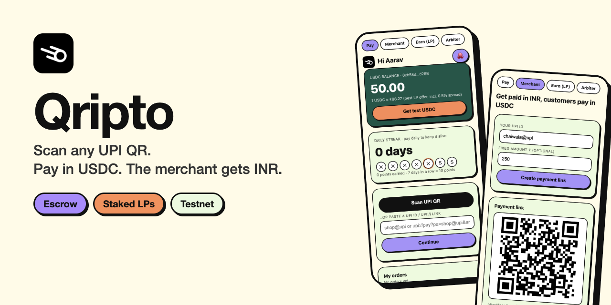

<br>

**A trust-minimised "Paytm for crypto" prototype.**<br>
On-chain escrow · staked liquidity providers · a payer app that feels like a normal payments app.

[**Live demo**](https://identification-successfully-tribute-continuity.trycloudflare.com) · [**How it works**](#how-it-works) · [**Quick start**](#quick-start) · [**Roadmap**](#roadmap) · [**Contribute**](CONTRIBUTING.md)

[](LICENSE)
[](https://github.com/Spyder15/Qripto/actions/workflows/ci.yml)
[](contracts/UpiEscrow.sol)
[](#tests)
[](#status-mock-vs-real)
[](CONTRIBUTING.md)
[](https://github.com/Spyder15/Qripto/stargazers)


<br>

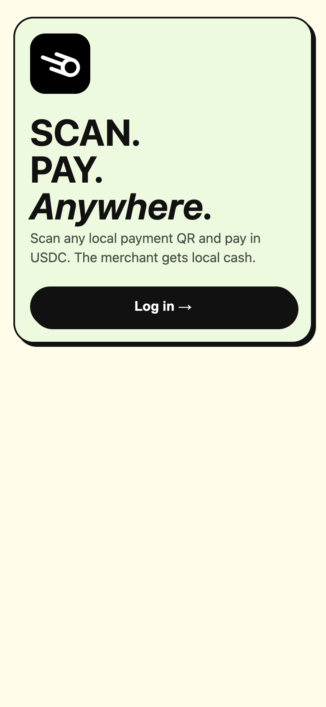
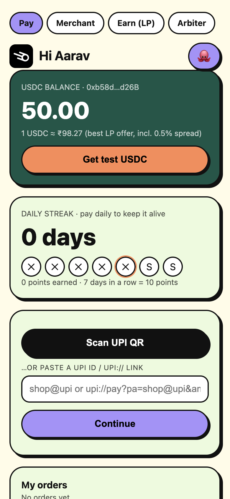
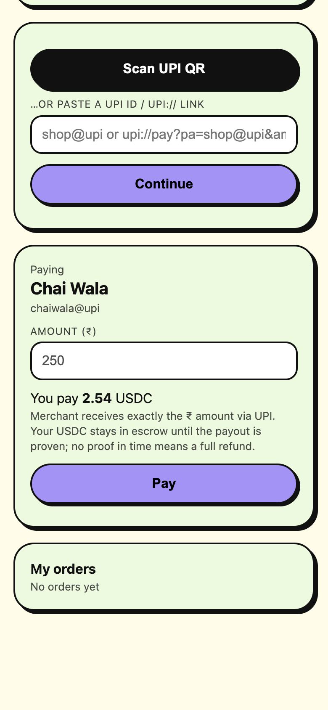
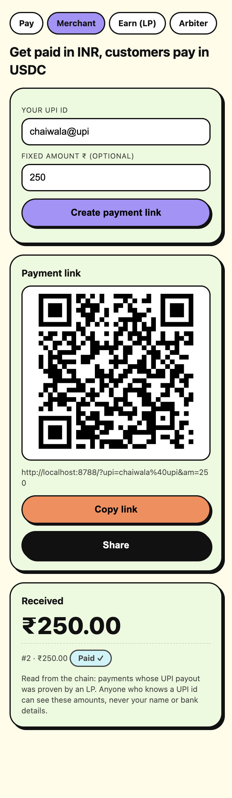

[](https://render.com/deploy?repo=https://github.com/Spyder15/Qripto)

<sub>The live demo runs from a laptop and may be offline. It uses test funds only.</sub>

### ▶️ Full flow in 80 seconds

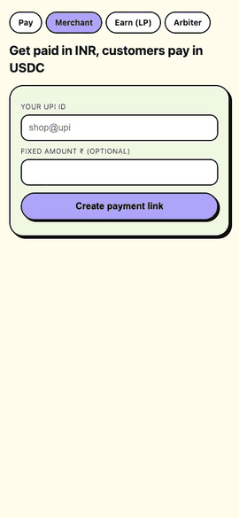

<sub>Merchant creates a link → payer creates a wallet and pays → LP fills it → payer confirms → merchant sees "Paid ✓". [Higher quality video](docs/demo.webm)</sub>

</div>

## Contents

[Why](#why) · [How is it different?](#how-is-it-different) · [How it works](#how-it-works) · [Features](#features) · [Screens](#screens) · [Quick start](#quick-start) · [Deploy](#deploy) · [Status](#status-mock-vs-real) · [Roadmap](#roadmap) · [FAQ](#faq) · [Contributing](#contributing)

---

## Why

Crypto holders can't pay a corner chai stall. Merchants only accept UPI. Existing bridges either hold your funds, ask the merchant to touch crypto, or need you to trust a company.

Qripto keeps the merchant on plain UPI and keeps the payer's USDC inside a smart contract until someone has proven the merchant was paid.

## How is it different?

| | Custodial on-ramp / OTC | P2P marketplace | **Qripto** |
|---|---|---|---|
| Who holds your USDC | The company | An escrow the company controls | A public smart contract |
| Merchant needs crypto | Sometimes | Yes | **No, plain UPI** |
| If the payout fails | Support ticket | Support ticket | **LP stake is slashed to you** |
| Scan-and-pay UX | No | No | **Yes** |

## How it works

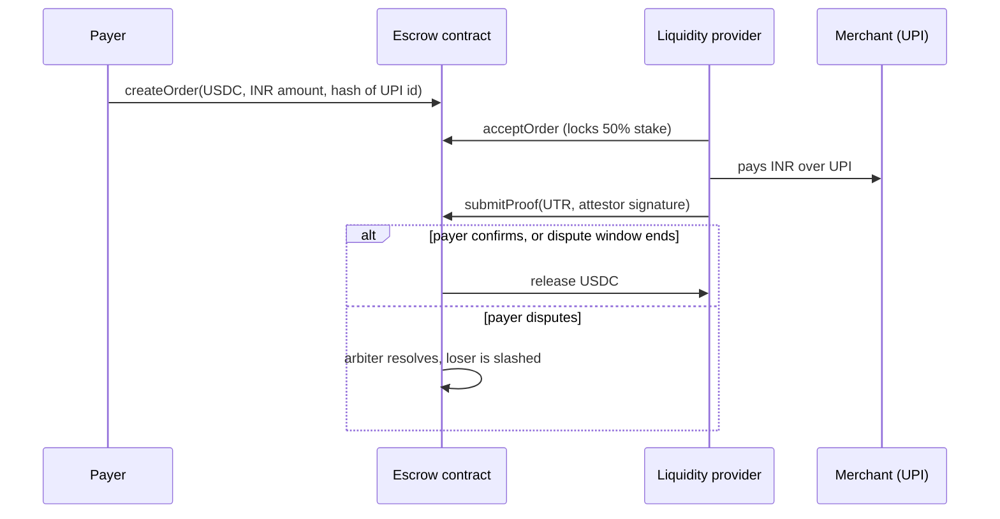

- **Payer** deposits USDC; funds are locked, not sent to anyone.
- **LP** fronts the INR, so the merchant sees a normal UPI credit.
- **Proof** of the UPI payout unlocks the USDC for the LP.
- **Protection:** the payer can dispute inside the window. LPs stake USDC and are slashed to the payer if they don't pay in time or lose a dispute.
- **Privacy:** only a hash of the merchant's UPI id goes on chain.

## Features

| | |
|---|---|
| 📷 **Scan or paste** any UPI QR / `upi://` link (EMV parser included) | 🔗 **One merchant link + QR** with a live "Paid ✓" ledger |
| 🔐 **Own your wallet:** create (12 words) or import, password-encrypted in the browser | 👤 **Profile:** name, avatar, saved merchants, history, recovery export |
| 💱 **Best-rate matching:** LPs publish rates, payers get the best staked offer | 🧾 **Receipts**, order notifications, daily streak and points |
| 🛡️ **Stake + slashing + disputes + arbiter** | 🌐 **Hindi toggle**, auto-lock, PWA install |
| 🤖 **LP bot** that quotes and fills orders | 🧪 **21 tests** for the contract and parser |

## Screens

<p align="center">
  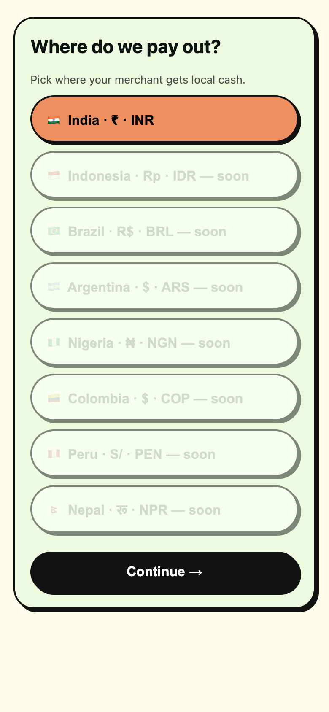
  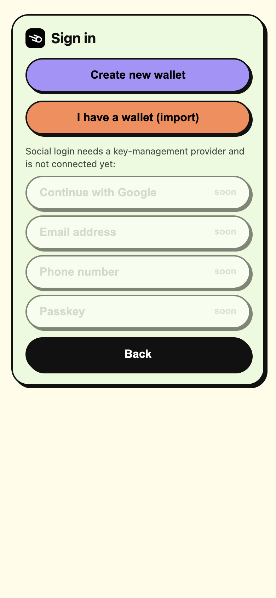
  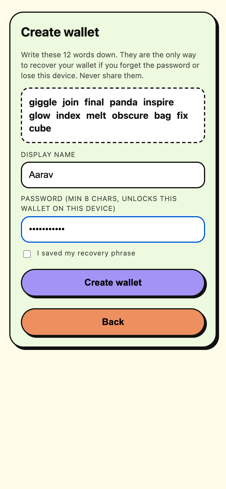
  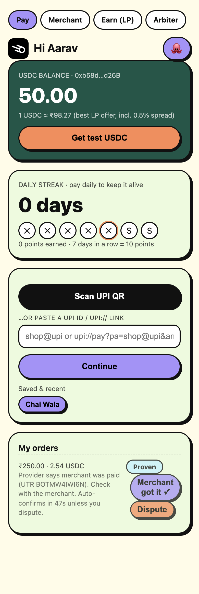
  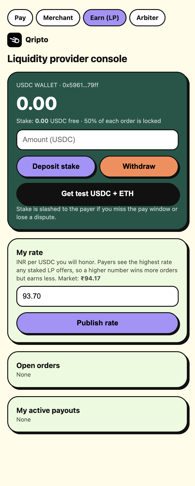
</p>

One app, four roles, switched with the tabs at the top:

| Tab | Who | What they do |
|---|---|---|
| **Pay** `/` | Anyone with USDC | Scan, confirm, pay, dispute or confirm |
| **Merchant** `/merchant` | Shop owner | Create a payment link or QR, see payments |
| **Earn (LP)** `/lp` | Liquidity provider | Stake, publish a rate, fill orders |
| **Arbiter** `/arbiter` | Dev only | Resolve disputed orders |

## Quick start

Requires Node 20+.

```bash
git clone https://github.com/Spyder15/Qripto.git
cd Qripto
npm install
DISPUTE_WINDOW=60 npm run dev     # local chain + contracts + app on http://localhost:8788
node app/lp-bot.js                # optional: an automated LP (mock payout)
```

Open <http://localhost:8788>, create a wallet, tap **Get test USDC**, then open `/merchant` in another tab, create a link, and pay it.

### Tests

```bash
npm test
```

<details>
<summary><b>Project layout</b></summary>

```
contracts/   UpiEscrow.sol, MockUSDC.sol
app/         server.js (API, RPC proxy, faucet), lp-bot.js, rate.js, providers.js, dev.js, prod.js
public/      payer.html, merchant.html, lp.html, arbiter.html, profile.html, common.js, emv.js
scripts/     deploy.js
test/        contract tests
docs/        screenshots
```

</details>

## Deploy

**Testnet (Base Sepolia):**

```bash
DEPLOYER_KEY=… BASE_SEPOLIA_RPC=… ATTESTOR_ADDRESS=… ARBITER_ADDRESS=… \
  npx hardhat run scripts/deploy.js --network baseSepolia
RPC_URL=… ATTESTOR_KEY=… node app/prod.js
```

**Public demo:** GitHub Pages can't host this (it needs a Node backend and a chain). Use the included `render.yaml` + `Dockerfile` on Render, or run `cloudflared tunnel --url http://localhost:8788` for a temporary link. The demo chain resets on every restart.

## Status: mock vs real

This is a **testnet prototype. Do not use real money.**

| Piece | State |
|---|---|
| Escrow, stake, slashing, disputes | ✅ Implemented and tested |
| Wallet vault, profile, merchant page, best-rate matching | ✅ Working |
| UPI payout proof | ⚠️ **Mock.** The attestor signs whatever UTR the LP submits |
| VPA name verification | ⚠️ Mock (only the QR `pn=` name is shown) |
| Social login (Google, email, phone, passkey) | ⏳ Not connected (needs Privy / Web3Auth) |
| Security audit, legal / RBI review | ❌ Not done |

## Roadmap

- [ ] Real payout proof (zkTLS / bank-statement attestation)
- [ ] Social login and passkeys
- [ ] Base Sepolia public deployment
- [ ] Verified VPA name lookup
- [ ] More corridors: PIX (Brazil), QRIS (Indonesia)
- [ ] Decentralised arbiter and LP reputation
- [ ] Independent contract audit

## FAQ

**Can I use real money?** No. Testnet only. The payout proof is a mock, so a dishonest LP could "prove" a payment that never happened. Fixing that is the main open problem.

**Why does the merchant not need crypto?** The LP pays them over normal UPI. The LP is the one who takes the USDC.

**What if the LP never pays?** The order times out, the payer is refunded, and the LP's locked stake is slashed to the payer.

**What if the payer lies and says they weren't paid?** They dispute inside the window; the arbiter decides and the losing side is slashed. A decentralised arbiter is on the roadmap.

**Does the chain see the merchant's UPI id?** No, only its keccak hash. The id stays in the backend's memory.

## Contributing

PRs and ideas are very welcome, especially on the **real proof** problem. See [CONTRIBUTING.md](CONTRIBUTING.md). Good first issues: translations, new country payout modules, UI polish, extra contract tests.

## Disclaimer

Experimental software for education and testnet use. It is not a licensed payment service, is unaudited, and is not legal or financial advice.

## License

[MIT](LICENSE) © 2026 Spyder15
